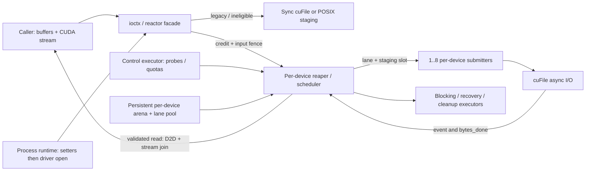

# Operating the cuFile reactor and opt-in async engine

**Default: `mode=legacy`. Do not flip it globally.** Real-GDS qualification is
not complete. In particular, the DISK/cuDF caller audit and CPU/soak/network
qualification remain outstanding. This guide describes the code, not every
future interface in the base design. Authoritative contract amendments:
[`gds-design/06-design-amendments.md`](gds-design/06-design-amendments.md),
especially AM-1, AM-9, AM-11, AM-13 and AM-15.

## Architecture



Implementation: `src/io/cufile/{cufile_ioctx,cufile_reactor,device_engine}.cpp`;
resource interfaces: `include/cucascade/io/cufile/{device_arena,lane_pool,operation}.hpp`.
The process owns one production engine/arena per CUDA device; first engine
configuration wins, later differences warn. Context destruction does not free
persistent engine allocations. Resource creation, filesystem probes and
registration run off the transfer path. Recovery synchronizes only owned lanes,
not the application device or stream. A stuck submit retains resources rather
than detaching a thread or pretending completion.

### Routing ladder

1. `legacy` preserves the existing synchronous reactor. Missing libcufile,
   disabled O_DIRECT, or unavailable file registration uses POSIX fallback.
   `compat_mode=on` forces POSIX; `off` requires cuFile registration; unset is
   `automatic`. `CUFILE_FORCE_COMPAT_MODE=true` controls libcufile separately.
2. An enabled context bootstraps runtime parameters at **construction**, before
   it can register files. Device engines are created lazily on the control
   executor. `async_auto` needs an open driver, the selected async symbol group,
   direct-capable properties and no forced compat. Host-only/mixed reads,
   original-null-stream reads, callbacks, disabled directions and ineligible
   files stay on existing paths.
3. Mount identity includes mount namespace, mount ID, fsid, device UUID and
   runtime generation. Overrides select **fsid > longest component-boundary
   mount prefix > filesystem type**, with earlier list entries breaking ties.
   Duplicate selectors are invalid. Once worker-discovered metadata/policy is
   cached, `legacy`/`known_compat` overrides do not create engine caller fences.
   Cold files record conservatively and fan out without coalescing; the caller
   never discovers mountinfo/geometry or creates policy. Optional fence/policy
   lookup failures skip the fence and safely retain legacy routing.
4. An unknown mount probes asynchronously and its current request stays legacy.
   A fast submit is **not** direct evidence. Built-in process-global evidence
   readers intentionally cannot automatically qualify a mount yet. Use a
   deliberately validated `operator_qualified` override, which is never called
   `verified_direct`. `probe.require_direct_evidence=false` and
   `async_simulated_for_testing` are test-only escapes, not production evidence.
5. Eligible device work uses registered staging slots; the unregistered tier
   additionally needs its policy qualification. Capacity fitting chooses actual
   QD/operation size from the available registered classes, lane and byte grants.
   Metadata exhaustion, unsuitable granules and unsupported routes stay/fall
   back to legacy. Reads may coalesce; writes require separate explicit opt-in.
6. Recognized file refusals (`EINVAL`, `EOPNOTSUPP`, `CU_FILE_IO_NOT_SUPPORTED`)
   demote only that live inode/direction. Other non-transient device/driver/CUDA
   errors (including unclassified EIO), as well as slow/stuck submits, open the
   mount circuit. ENOSPC/EACCES/EDQUOT do not demote. Queued, unstarted work can fall back;
   submitted work must first prove quiescence. Unknown-progress writes are never
   replayed. See the troubleshooting section before changing breaker thresholds.

## Enabling on a qualified GDS host

Collect evidence first using `tools/gds/collect_topology.sh --probe-dir /mnt/disk_2`
and the recipes in `tools/gds/README.md`. Match `gdsio` concurrency and I/O sizes.
Do not infer GDS from async QD scaling, NFS mount type, `nconnect`, or low submit
latency. Run the content-verifying smoke before any `--verify 0` throughput run.

Example configuration (adapt mount/profile/limits to the host):

```cpp
using namespace cucascade::io::cufile;
config cfg;
auto& a = cfg.async_engine;
a.mode = engine_mode::async_auto;
a.async_reads = true;
a.async_writes = false;                 // independent, not implied by read qualification
// a.affinity = true;                   // optional; default off
// a.arena_bytes = 512UL << 20;          // otherwise auto
mount_override mount;
mount.value = "/mnt/disk_2";            // normalized mount prefix
mount.state = mount_override_state::operator_qualified;
mount.qd = 32;
mount.op_bytes = 4UL << 20;
// mount.lanes = 40;                    // optional ceiling; capacity may reduce further
// mount.nic = "mlx5_0";                // RDMA name or BDF; placement, NOT NIC routing
// mount.cpus = {8, 10};                // explicit submitter candidates within cpuset
// mount.allow_writes = true;           // only AFTER client/version write qualification
// a.async_writes = true;               // both settings required for override writes
a.mount_overrides.push_back(mount);
// Set process params BEFORE any cuFile user opens the driver:
// a.process_params.max_device_pinned_mem_size_kib = 1UL << 20;
// a.strict_parameters = true;
```

Construct `cufile_reactor::reactor_context(cfg)` and a `cufile_ioctx` with it;
start the context before submitting. Applications using `io_config` choose
`io_backend::cufile` and set `io_config.cufile.async_engine`. The configuration
structs are present even in builds without the backend; selecting an unavailable
backend does not manufacture a cuFile implementation.

### Arena size, registration and AM-9

`arena_bytes=0` selects the 16-MiB-rounded minimum of 1 GiB, 5% of device memory
and reservable memory. Registration is separately constrained by live BAR1 and
the cuFile pin limit. An explicit allocation target is not a guarantee of
registered capacity. Default bootstrap uses `cudaMalloc`; reservation-manager
integration remains open.

`device_arena_options` is a **control/bootstrap** API, not nested in
`async_engine_config`. For advanced provisioning, obtain
`device_arena::for_device(device, options)` before automatic engine creation.
Prepare `slab_classes` for the expected 1/2/4/8-MiB profiles. Defaults prepare
only 1-MiB slots, so `op_bytes=4 MiB` alone does **not** guarantee 4-MiB I/O.
Slot registrations cannot be reshaped during transfers. Observe
`engine_gauges.mounts[].effective`, not just requested preferences.

**AM-9 warning:** libcufile 1.17 compat has demonstrated silent cross-slot
corruption with shared arena **and slab** registrations, even with full successful
`bytes_done`. Default `registration=slot` uses independent registered bases and
buffer offset zero. `allow_shared_registration=true` is an unsafe diagnostic
opt-in, not qualification. Shared layouts require content-validated real-GDS
G-gate evidence for that exact granularity; never accept a zero-filled test file
or bytes-count-only verification as correctness evidence.

### Process parameters

`runtime::ensure_initialized(process_params, strict_parameters)` freezes the
**entire first request**, including omitted fields. Repeating exactly is safe;
a later differing request is reported, ignored, and throws in strict mode.
The no-argument overload joins the frozen runtime rather than requesting defaults
when already initialized. If it runs first (including a legacy file open, arena or
lane bootstrap), it freezes an empty/default request; later explicit parameters
are ignored, or rejected in strict mode.
Set parameters before any other library's driver open, property probe or file
registration. All defaults are **unset**, meaning no setter call. Even a legacy
context can explicitly request process parameters without enabling the engine.

`cmake/ConfigureCuFile.cmake` detects declarations and enum identifiers;
`src/io/cufile/parameters.cpp` casts opaque ABI slots only inside validated
adapters. No numeric parameter IDs are guessed. The shared driver transaction
serializes setters → driver open → properties → readback. There is no
`cuFileDriverGetP2PFlags` call, driver close/reopen, or driver-open retry.

| `process_params` field | Type / units | Setter / readback in the installed 1.17 header |
|---|---|---|
| `allow_compat_mode` | optional bool | `Bool`, `PROPERTIES_ALLOW_COMPAT_MODE` |
| `force_compat_mode` | optional bool | `Bool`, `FORCE_COMPAT_MODE` |
| `max_direct_io_size_kib` | optional size, KiB | `SizeT`, `PROPERTIES_MAX_DIRECT_IO_SIZE_KB` |
| `max_device_pinned_mem_size_kib` | optional size, KiB | `SizeT`, `PROPERTIES_MAX_DEVICE_PINNED_MEM_SIZE_KB` |
| `max_device_cache_size_kib` | optional size, KiB | `SizeT`, `PROPERTIES_MAX_DEVICE_CACHE_SIZE_KB` |
| `rdma_dev_addr_list` | optional vector of strings | unsupported: no typed setter/ID; use JSON |
| `rdma_load_balancing_policy` | optional string | unsupported: no typed setter/ID; use JSON |
| `gpu_bounce_buffer_slabs` | optional `{sizes_kib, counts}` vectors | paired GPU bounce slab setter/getter |
| `stats_level` | optional size | `SizeT`, `PROFILE_STATS` |
| `logging_level` | optional string | `String`, `LOGGING_LEVEL` |

The full API names have `cuFileSetParameter` / `cuFileGetParameter` prefixes and
enum IDs have `CUFILE_PARAM_` prefixes. Size ceilings must be positive.
Bounce sizes must be strictly ascending positive multiples of 4 KiB, with an
equal-length positive count array. Strings cannot be empty or contain NUL.
Vendor-specific value ranges are left to the actual setter.

`init_report.parameters` reports each requested value as:

- **applied:** setter accepted and effective readback matched;
- **unapplied:** a driver-open attempt preceded initialization, an external
  already-open driver was detected, or the setter rejected the value;
- **unsupported:** no library, validated adapter or setter symbol;
- **unverified:** accepted, but getter missing/failed, or driver open failed.
  Acceptance alone never implies the setting took effect;
- **differs:** accepted, but readback contradicts the requested value.

Strict mode rejects unsupported/unapplied/differs requests and differing frozen
requests. It permits unverified values; inspect the report when verification is
mandatory. A strict failure does not unfreeze or undo initialization.
Versioned, commented configuration templates live in
[`cufile-profiles/`](cufile-profiles/README.md). Strip comments and select the
result via `CUFILE_ENV_PATH_JSON` **before process initialization**. RDMA JSON
policy is distinct from engine thread placement.

### Affinity (optional, default off)

`src/io/cufile/topology.cpp` discovers the CUDA GPU's BDF/NUMA node, RDMA device
BDFs/nodes under `/sys/class/infiniband/*/device`, physical CPU package/core IDs,
node CPU lists, and the bootstrapping thread's allowed mask via `sched_getaffinity`.
This conservatively respects thread inheritance; it is not discovery of the
process-wide cpuset. A broken NIC device symlink is skipped independently.
It reuses `memory::parse_cpu_list` through the topology library already linked
by core/IO. The general `memory::topology_discovery` provides wider NVML/network
inventory, but its GPU discovery lacks the root-injected physical-core/cpuset
planner needed here; the small IO reader keeps tests independent of live sysfs.

The reaper is GPU-local. Submitters choose a same-node NIC before other NICs
(deterministic name tie-break), use NIC-local distinct physical cores, and fall
back to GPU-local cores if there is no NIC or permitted NIC-local core. SMT
siblings/shared CPUs are used only after candidate physical cores are exhausted.
Live device plans share a process core-reservation list; retired engines release
their reservations (incomplete engines retain them). Only `nic`/`cpus` overrides
get mount-specific plans, which avoid that engine's reserved cores. QD-only,
legacy and compat entries without placement use the shared default plan. A `nic` override selects RDMA name or
BDF; `cpus` supplies explicit submitter candidates, intersected with the permitted
mask, taking precedence over NUMA preference. No permitted explicit CPU, unknown
GPU node, malformed/missing sysfs, or an unknown explicit NIC means no pinning,
with a reason.

Discovery and planning run during control-thread construction. A submitter
resolves a policy's override by `{match, value}` against the engine's first
configuration, never by another context's list index. It applies the precomputed
plan only when the CPU changes; it restores its
inherited permitted mask for an unpinned plan. Only the reaper and submitters
call the thread-affinity syscall. **Application-thread affinity is never changed.**
The gauges expose CPU, node, NIC name/BDF, pin success and reason. A rejected
pin is nonfatal. Hotplug/cpuset rediscovery, storage-endpoint reachability,
vendor-specific NIC eligibility, routing steering, and NUMA first-touch of the
shared blocking-pool scratch are not implemented by this placement policy.
`device_engine_options::{sysfs_root,gpu_bdf,permitted_cpus}` inject discovery
inputs for isolated tests; production defaults to live discovery.

## Configuration reference

Defined in `include/cucascade/io/cufile/config.hpp`. `*_bytes` are bytes;
`*_us`, `*_ms`, `*_s` carry the stated time units. Configuration validation is
syntactic and does not qualify hardware.

### Reactor `config` (legacy fields retain their meaning)

| Field | Default | Meaning |
|---|---|---|
| `n_max_concurrent_scans` | pipeline width, currently 4 | readahead scan limit; 0 disables |
| `n_max_concurrent_scans_explicit` | false | preserve explicit scan limit against derived defaults |
| `max_inflight` | 32 | parked slices / fallback copies per reactor |
| `max_op_bytes` | 64 MiB | maximum synchronous cuFile piece |
| `register_min_bytes` | 0 | transient legacy buffer registration threshold; 0 disables creation |
| `write_split_bytes` | 0 | facade write splitting; 0 means none |
| `gds_threshold` | 256 KiB | minimum legacy device cuFile transfer |
| `use_odirect` | true | allow direct fd / file registration |
| `compat_mode` | unset (`automatic`) | automatic, on (POSIX), off (require registration) |
| `poll_interval_us` | 200 | idle fallback-copy poll delay |
| `low_service_interval` | 4 | legacy high starts before one low turn; 0 strict priority |
| `async_engine` | defaults below | independent opt-in engine configuration |

`min_alignment_requirement()` and `merge_gap_size()` both report 4096 bytes;
per-file engine granules can be larger.

### `async_engine_config`

| Field | Default | Meaning |
|---|---|---|
| `mode` | `legacy` | `legacy`, `async_auto`, `async_simulated_for_testing` |
| `async_reads` / `async_writes` | true / false | independent directional switches |
| `unregistered_device_tier` | true | allow policy-qualified unregistered staging |
| `direct_registered_io` | false | reserved direct-caller-buffer opt-in; no direct route implemented |
| `stream_register` | true | register owned lanes when symbols exist; page-aligned-input flag only |
| `affinity` | false | optional owned-thread placement |
| `coalesce` / `coalesce_max_targets` | true / 64 | small-read grouping; cap validates 1..4096 |
| `submitters_per_device` | 1 | shared submitters; validates 1..8 |
| `arena_bytes` | 0 (auto) | allocation target, not a registration guarantee |
| `device_lane_cap` | 160 | positive maximum owned lanes, at most 160 |
| `max_pending_slices_per_device` | 4096 | bounded metadata, at most 2^20 |
| `low_service_interval` | 4 | positive engine fairness interval |
| `max_short_reads` | 64 | positive continuation bound |
| `mount_overrides` | empty | routing, capacity and placement overrides below |
| `process_params` | all unset | frozen process allowlist above |
| `strict_parameters` | false | reject unsupported/unapplied/conflicting requests at context creation |
| `probe.submit_max_us` / `probe.bytes` | 100 / 16 MiB | nonblocking-submit probe threshold and size |
| `probe.require_direct_evidence` | true | false is test-only timing qualification |
| `demotion.slow_floor_us` / `p99_multiple` | 100 / 4 | rolling slow-submit threshold |
| `demotion.slow_of_last_eight` | 3 | slow samples opening circuit; 1..8 |
| `demotion.stuck_ms` | 2 | submit watchdog threshold |
| `demotion.cooldown_s` / `cooldown_cap_s` | 30 / 960 | exponential requalification cooldown bounds |
| `poll.io_cap_us` / `copy_cap_us` | 100 / 10 | latency-adaptive floors; each validates 1..1000 |
| `poll.fence_hint_us` | 100 | fence-hint/copy deferral interval; validates 1..1000 us |
| `poll.due_events_per_round` | 16 | event-query work budget |
| `poll.idle_health_ms` | 20 | idle health fallback wake interval |

The actual I/O poll ceiling is `clamp(p50 completion / 8, io_cap_us, 1000 us)`.
Copy/stage tails start at 2 us and use a scaled ceiling capped at
`max(250 us, copy_cap_us)` (AM-15). Unrelated notifications do not bypass deadlines.
Transient reads get at most three attempts with 10/20-ms backoff and up to 25%
jitter; that policy is currently fixed, not an unimplemented `retry` config field.
This recognizes negative POSIX ESTALE/EAGAIN/ETIMEDOUT/ENOTCONN results, plus
network EIO only with a positive injected filesystem-specific classifier. Raw
positive `CUfileOpError` submit codes and negative `CU_FILE_*` completions are
not mapped to transient errno. Real cuFile may return `-1` or vendor codes rather
than errno, so the retry claim is limited to the simulator/seams and paths that
actually expose negative errno (including compat/synchronous POSIX fallback).
Vendor error-encoding qualification requires Phase 7 real-client fault evidence.

Each `mount_override` has `match=mount_prefix`, `value` (required),
`state=legacy`, optional `qd`, `op_bytes`, `lanes`, `nic` (all unset),
`cpus={}`, and `allow_writes=false`. `match` can also be `fsid` or `fs_type`;
`state` can also be `operator_qualified` or `known_compat`. `allow_writes=true`
requires `operator_qualified`. Positive lane caps limit fitting, not preallocation.
An fsid selector is lowercase hex of **raw** `f_fsid` bytes, not necessarily
`stat -f -c %i`. Prefixes must be normalized absolute paths.

### `device_arena_options` (advanced bootstrap)

| Field | Default |
|---|---|
| `registration` | `slot` (alternatives: unsafe/unqualified `slab`, `arena`) |
| `allow_shared_registration` | false |
| `initial_class` | `mib1` |
| `slab_classes` | empty: repeat `initial_class` |
| `bar1_fraction` | 0.5 |
| `bar1_headroom` | 64 MiB |
| `registration_first_step` | 64 MiB; conservative cap when BAR1 is unknown |

### Filesystem starting profiles

Static table: `src/io/cufile/mount_policy.cpp::profile_for_filesystem`.
These are operational starting preferences, **not frozen hardware tuning**.
QD/op-size sweeps, including AM-5's 2-MiB versus filesystem-block comparison,
remain required before claiming qualification. Lanes are `QD + ceil(QD/4)`;
capacity fitting can reduce all effective values. Mount `lanes` is an additional
ceiling. Idle grants are borrowable; in-flight leases are not revoked.

| Class / discovered type | QD | Preferred operation | Requested lane headroom |
|---|---:|---|---:|
| Local NVMe (`ext4`, `xfs`) | 32 | 4 MiB | 40 |
| GPFS (`gpfs`) | 64 | validated block size clamped to 1..8 MiB | 80 |
| WEKA (`wekafs`) | 64 | 2 MiB | 80 |
| VAST / NFS-RDMA preference (`nfs`, `nfs4`, `vastnfs`) | 64 | 1 MiB | 80 |
| Lustre | 64 | discovered stripe, otherwise 1 MiB; available classes cap at 8 MiB | 80 |
| BeeGFS | 64 | 2 MiB fallback | 80 |
| Compat / unknown | 4 | 1 MiB preference (legacy still uses its own 64-MiB maximum) | 5 if fitted; legacy has no engine lane demand |

NFS classification gives only a capacity preference, never proof of RDMA or
permission to use async. `known_compat` overrides select the compat profile.
Granules use the maximum of 4096, page size and reported STATX DIO alignment.
Without STATX_DIOALIGN the fallback is max(4096, page size), never `f_bsize`;
a reported zero alignment means no direct I/O and forces legacy. `f_bsize` is
used only for GPFS geometry, after validating GPFS magic. Lustre's optional
ioctl uses a maximum-stripe V3 buffer and accepts only V1/V3 layouts with a
positive granule-multiple stripe; other results fall back to 1 MiB. Composite
layouts and BeeGFS per-file chunk discovery remain qualification work.
Mount-profile granule/geometry and Lustre/BeeGFS preferences are a **first-file
sample**, not a mount-wide alignment/stripe guarantee; transfers discover their
own per-file geometry. Unsupported slot/granule combinations remain legacy.
Small reads may coalesce inside one repeating geometry unit, never across its
boundary; explicit arbitrary boundary vectors still disable grouping.

## Gauges and diagnostics

Access `device_engine::try_get(device)->gauges()` after checking for null,
`device_arena::gauges()`, `mount_policy::gauges()` and the immutable runtime
initialization report. Snapshots are eventually consistent, not completion
barriers. Engine metrics are **per device**, not duplicated/additive per facade.
A mount snapshot includes `mount_id`, requested `profile`, fitted `effective`
(`qd`, `op_bytes`, `lanes`), current/max QD and occupied lanes.

| Group | Exported names / interpretation |
|---|---|
| Queue/capacity | `storage_qd`, `max_storage_qd`, `outstanding_slices`, `live_operations`, `mean_storage_qd`, `backlog_mean_storage_qd`, `lanes_by_phase`, `mounts[]` |
| Additive time integrals | `accounted_ns`, `storage_qd_ns`, `backlog_ns`, `backlog_storage_qd_ns`; use differences for warm-up-excluding windows |
| Backpressure | `slot_waits`, `lane_waits`, `slot_wait_ns`, `lane_wait_ns`, `refill_gap_ns`, `metadata_rejections`, `metadata_fallbacks` |
| Polling/CPU | `queries`, `completed_ops`, `queries_per_op`; `io_queries`, `copy_queries`, `stage_queries`, `fence_hint_queries` and corresponding `*_queries_per_op`; `reaper_iterations`, `reaper_active_ns` |
| Latency | `submit`, `completion`, `residence`, `io_poll_delay`, `copy_poll_delay`: log2-nanosecond histograms with `buckets`, `count`, `total_ns` |
| Health | `retries`, `short_reads`, `recoveries`, `quarantines`, `cancellations`, `not_submitted`, `unsupported_fallbacks`, `late_copy_failures` |
| Coalescing | `coalesced_ops`, `coalesced_targets`, `gap_bytes` |
| Read transport | `async_registered_bytes`, `async_unregistered_bytes` (bounce tier), `sync_bytes`; these do not independently prove a direct filesystem path |
| Writes | `async_write_bytes`, `direct_write_bytes`, `buffered_write_bytes`, `short_writes`, `buffered_suffixes`, `granule_conflicts`, `granule_wait_ns`, `quarantined_write_intervals` |
| Host memory/flush | `pinned_write_scratch_bytes`; `pinned_write_scratch_pool_bytes` and `flush_waits` are **process-wide**, not additive across devices |
| Logical completion | `enqueued_logical_bytes`: exact successful target bytes, not physical widened/coalesced I/O bytes |
| Placement | `reaper_affinity`, `submitter_affinity[]`: `cpu`, `node`, `nic`, `nic_bdf`, `pinned`, `reason`; submitter entry describes its most recently selected mount plan |
| Mount policy | `state`, `probes`, `probes_passed`, `probes_failed`, `demotions`, `cooldowns`, `cooldown`, `last_probe`, `last_trigger`, `trigger_elapsed`, `median_submit`, `median_completion`, `healthy_p99` |
| Arena | `total_bytes`, `registered_bytes`, `unregistered_bytes`, `reserved_bytes`, `slabs`, `registered_slabs`, `partially_registered_slabs`, `live_leases`, `live_probe_leases`, `draining_slabs`, `pending_slabs`, `reclassifications` |
| Runtime | library/open/property statuses, optional async/read/write/stream/batch/parameter groups, forced compat, frozen parameters, per-parameter status/reason, generation and conflicting-request flag |

`lane_pool::available()` / `quarantined()` expose pool state. Warm-up reports
allocation/registration targets, first registration step, failures and BAR1
availability. Do not present absent metrics as zero-cost proof: per-tier queue
latency, refill histograms, wake/timer overhead and vendor direct-path attribution
still need dedicated qualification instrumentation/benchmarks.

## Completion contract and caller obligations (AM-1)

For **engine device reads on explicit non-PTDS streams**, successful future
completion means all I/O counts were validated, final D2D copies were **enqueued**,
and the reaper inserted waits for those copies onto the caller's stream. It does
**not** mean the copies have executed. Wait for the future **before** enqueueing
consumer work that must follow the reaper's join; then order that work on the
same stream, or synchronize that stream before host/foreign-stream access.
Retain the destination and required stream ownership through that ordering.
Do not capture CUDA graphs on that stream while a read/join is in flight.

Original PTDS reads are host-complete; original null streams conservatively stay
legacy. Legacy/compat/POSIX reads remain host-complete (a stronger guarantee).
Routing can change per request, so enabled-context callers must always obey the
weaker enqueued contract. `late_copy_failures` and stream/context synchronization
expose copy errors after early success; a resolved future cannot be revoked.
Slots, lane/event arguments, file and other internal owners remain retained
until the copy event proves quiescence. Cancelling a future does not authorize
freeing memory still touched by GPU work.

Writes are host-observed complete, **not durable**. Retain their sources until
completion; the input fence orders staging after caller work. Flush uses
inode-sequence tracking and `fdatasync`; it waits for writes captured before the
flush, never later sequence tickets. Unknown write progress fails without replay.
See `include/cucascade/io/io_context.hpp`, `device_engine.cpp` and
`file_write_state.cpp`. The unaudited cuDF/DISK callers are a reason the engine
remains opt-in; enabling it does not silently upgrade their assumptions.

## Troubleshooting

- **Still legacy / compat:** inspect `platform.cpp`/`probe_object`, optional symbol
  groups, driver properties and forced-compat environment. Missing libcufile or
  `dstatusflags=0` prevents production async eligibility. A fast compat async call
  is possible in 1.17; timing is not direct evidence. Check mode, direction flags,
  mount precedence, registration, null-origin stream, granule fit and first
  engine configuration. `operator_qualified` is an assertion, not measurement.
- **Parameter warning / strict failure:** another component may already have
  opened the driver. Start a new process with earlier configuration; never close
  and reopen a live cuFile driver. An accepted setter can read back a different
  effective value on this release: the runtime reports `differs` and strict mode
  rejects it. Missing/failed getters alone remain `unverified`.
  Missing RDMA setters require release-supported JSON rather than guessed IDs.
- **BAR1 / registration failures:** inspect live BAR1 with NVML/`nvidia-smi`,
  pin-limit ceilings, `registered_bytes`, partial slabs and warm-up failure
  counters. Unknown BAR1 conservatively caps registration at 64 MiB. Reduce
  requested QD/op size or provision the right slot classes; do not waive AM-9 or
  register one-shot caller buffers blindly. External pin consumers are not fully
  accounted by the engine's registration table.
- **Circuit breaker:** `unknown → probing → verified_direct/degraded_async`, or
  explicit `operator_qualified`; platform compat/unsupported evidence prevents
  eligibility. Non-file-local non-transient failures, rolling slow-submit
  observations or the stuck watchdog move to
  `circuit_open`; drain precedes `cooldown`, with exponential bounded retries.
  Standing overrides reset backoff to its initial value after 1024 healthy submits
  since the previous trip; without that window it still doubles to the cap.
  Inspect `last_trigger` (slow-of-eight / stuck / failure), `trigger_elapsed`,
  `last_probe`, histograms and per-inode demotion before calibrating limits.
  Submitted work is not safely cancellable merely because a watchdog fired.
  A delayed write submit that returns success with a recorded event still follows
  normal event/bytes_done validation; a watchdog observation alone does not fail
  that known-successful submission or authorize replay (AM-18).
- **Arena lifetime:** an explicitly supplied `device_engine_options::arena` is
  non-owning and must outlive the engine, including incomplete drain/quarantine.
  Destroying the facade first can make final-owner nonblocking lease returns
  refuse forever and livelock teardown. Production registry arenas are process-lifetime.
- **Lane quarantine / drain false:** recovery replaces the suspect stream and
  both events only after owned-lane synchronization proves quiescence. Failed
  synchronization/replacement retains quarantine and associated slots/intervals
  for process lifetime. A quarantined write interval can indefinitely block an
  overlapping write/flush on that inode; disjoint work can progress. Do not
  forcibly recycle it, detach submitters, reopen by pathname, or replay unknown
  progress. `quarantined_write_intervals`, warnings and incomplete drain are
  intentional safety diagnostics; investigate driver/device/client health.
- **No affinity:** default is off. GPU NUMA `-1`, missing physical-core metadata,
  hidden RDMA sysfs, cpuset restrictions, invalid overrides and failed pin syscalls
  all have diagnostic reasons. CPU placement does not configure libcufile paths.

## Qualification gates: default must remain legacy

Source: `gds-design/05-final-design.md` §8, amended by AM-7/AM-9/AM-13/AM-15.
Compat/ext4 simulator or cached runs do not pass real-GDS gates.

| Gate | Required evidence |
|---|---|
| G-1 | B-0 GPFS async QD 32 throughput at least 4× QD 1; revisit transport if not met |
| G-2 | B-3 reads, B-4 restore, B-5 large buffer and B-6 writes each at least 80% of matched B-2 real-GDS baseline on NVMe, GPFS, WEKA and VAST, with attributable direct evidence |
| G-3 | No generation-wide refill gaps; time-weighted storage QD at least 90% of fitted QD while backlog exists |
| G-4 | B-10 compat read/write regression within 5% with confidence; compat default unchanged |
| G-5 | B-1/B-3 meet CPU and lane-residence budgets, or retune/document before default flip: target 8 event queries/op, ceiling 70; ≤12 us submit, ≤10 us reaper bookkeeping, ≤5 us timer/notification per op, ≤1 core at 10k 1-MiB ops/s and QD ≤64; post-I/O mean ≤65 us and storage QD ≥95% of fitted target |
| G-6 | Full §8.1 test/fault matrices, including T-29/T-32 and thread sanitizer where supported |
| G-7 | Stable resources across a one-hour warmed soak, repeated context lifecycles included |
| G-8 | Only flip default after G-2..G-7 pass on local NVMe and one network FS; other classes stay override-gated |

Run registration-granularity concurrent **content** validation as part of the
G-gates, plus path-loss/server-pause/stale-handle tests without pathname reopen.
AM-13's intrusive scheduling/incremental accounting/batched cleanup/parked-only
notification CPU work and the isolated direct-evidence interval remain open.
Neither these profiles nor affinity support claims those gates have passed.
